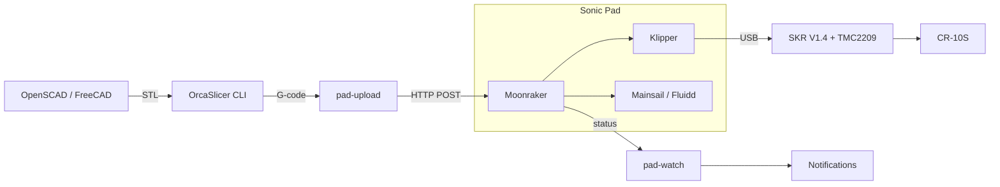

<div align="center">

# cr10s-klipper-upgrade

Upgrade a Creality CR-10S to Klipper, then make printing a one-command, monitored workflow.

[](https://github.com/jeffskinnerbox/cr10s-klipper-upgrade/stargazers)
[](https://github.com/jeffskinnerbox/cr10s-klipper-upgrade/commits/main)


</div>

## What is this?

A build log and toolkit for upgrading a 2018 Creality CR-10S (300x300x400mm) from stock Marlin to Klipper.
The hardware is a Creality Sonic Pad (Klipper host), a BigTreeTech SKR V1.4 mainboard with TMC2209 drivers,
a CR Touch probe, and a BTT Smart Filament Sensor V2.
The repo will hold the assembly and wiring guides, the Klipper config, and Python/Bash scripts
that replace the manual Cura-and-SD-card routine with `make upload`.

## Status

Planning stage. No code or wiring guides yet.
Next up: a product requirements document (`docs/prd.md`) and a phased implementation plan (`docs/plan.md`).

## How it will work

The desktop designs, slices, and uploads. The Sonic Pad stores the G-code, runs the print, and serves the web UI.
A person always starts the print, because someone has to clear the bed.



| Machine        | Role                                                      |
| :------------- | :-------------------------------------------------------- |
| Desktop Ubuntu | CAD, slicing, `make` automation, scripts, git backups     |
| Sonic Pad      | Klipper host, Moonraker API, web UI, webcam, G-code store |
| SKR V1.4       | Klipper MCU firmware: steppers, heaters, probe, sensors   |

## Project Structure

```text
cr10s-klipper-upgrade/
├── docs/                 # reference notes (CR-10S, slicers, upgrade links)
├── input/                # source material: vision, workflow research, prompts
├── CLAUDE.md             # guidance for Claude Code
└── README.md
```

## Documentation

| Resource                                                                                      | Description                                                    |
| :-------------------------------------------------------------------------------------------- | :------------------------------------------------------------- |
| [input/my-vision.md](input/my-vision.md)                                                      | Upgrade goals, parts list, sources, and the Sonic Pad concern  |
| [input/new-workflow.md](input/new-workflow.md)                                                | Researched CAD → STL → G-code → print workflow and test phases |
| [docs/creality-cr-10s-3d-printer.md](docs/creality-cr-10s-3d-printer.md)                      | General CR-10S, filament, and slicer notes                     |
| [docs/creality-cr-10s-sonic-pad-klipper-skr-upgrade.md](docs/creality-cr-10s-sonic-pad-klipper-skr-upgrade.md) | Sonic Pad / SKR / Klipper upgrade links                        |

## Safety

Mains-powered heaters and stepper wiring are involved.
Unplug the printer before any wiring work, and never leave a print running without a way to stop it.
