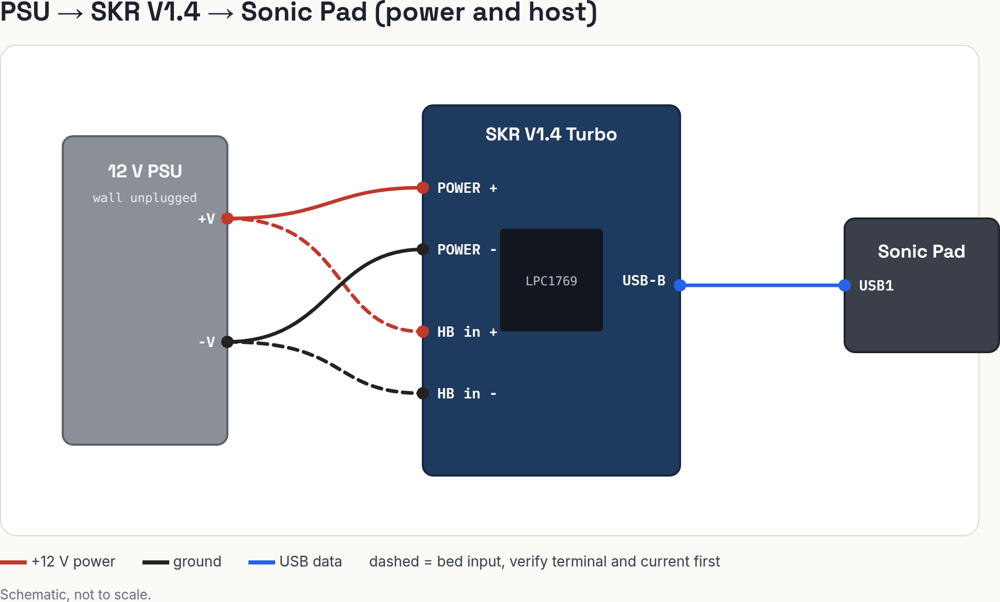

# 00 Power and host wiring

Wire the PSU, the SKR V1.4 power input and the USB link to the Sonic Pad. This is the first wiring step. Do it on the bench, with the printer's old board still in the printer.

> **Verify before you wire.** Several facts here come from general knowledge of the SKR V1.4, not from this repo's research. Items marked **(verify)** must be checked against the silkscreen on your board and BTT's V1.4 manual before you connect power. A wrong polarity can destroy the board.

## Wiring — PSU to SKR V1.4

| Board Pin | Module Pin | Signal/Function |
| :-- | :-- | :-- |
| `POWER` `+` (VIN) | PSU `+V` | +12 V main power (board, drivers, fans, hot end) |
| `POWER` `-` (GND) | PSU `-V` (COM) | Ground |
| `HB` power in `+` | PSU `+V` | +12 V for the heated bed **(verify the exact terminal)** |
| `HB` power in `-` | PSU `-V` (COM) | Ground for the heated bed **(verify)** |
| USB-B | Sonic Pad `USB1` | Data link to Klipper (and 5 V, see the jumper below) |

Wire gauge: 16 AWG or thicker for `POWER`. 14 AWG or thicker for the bed. Use ferrules or tin the ends, and tighten the screw terminals until the wire does not move when pulled.

## Heated bed current — decision needed

The CR-10S 300x300 bed on 12 V draws a high current.
The SKR V1.4 `HB` output is a MOSFET with a limit near 10 A **(verify in the manual)**.
If the bed draws more than that, do not connect it to `HB`.
Use an external MOSFET or SSR module for the bed, driven by the `HB` signal.
Measure the bed's resistance with a multimeter (power off, bed disconnected) and work out the current: `I = 12 V ÷ R`.
Write the result in `docs/build/test-log.md`. Do not wire the bed until this is decided.

## USB power jumper

The SKR V1.4 can take 5 V from USB.
If USB and the PSU both feed the 5 V rail, they can fight each other, and the Pad's USB port can be stressed.
BTT's guidance is to remove the USB-power jumper when the board is powered from the PSU and linked to a host **(verify the jumper name and position on your board)**.

| Situation | Jumper |
| :-- | :-- |
| Flashing and desk checks, USB only, no PSU | In (board powered by USB) |
| Board on the PSU and linked to the Pad | Out |

Never connect the PSU and a USB-powered host with the jumper in until you have checked this.

## Pre-power checklist

Do every step with the PSU **unplugged from the wall**. Take a photo at each photo checkpoint and keep it with `docs/build/test-log.md`.

- [ ] Photo 1: the PSU terminals and labels (`+V`, `-V`, `L`, `N`, earth). The mains side is covered.
- [ ] Set the PSU to 12 V if it has a voltage switch.
- [ ] Measure PSU output with the wall plug in and nothing connected: 12 V ±0.5 V. Unplug again.
- [ ] Red wire on `+V`, black wire on `-V`. Check the colors against the PSU label, not by habit.
- [ ] Photo 2: the wires on the SKR `POWER` terminal, before you tighten them.
- [ ] Continuity: PSU unplugged, meter on resistance. `POWER +` to `POWER -` must **not** read near 0 ohm. A short means stop.
- [ ] Continuity: `POWER -` on the board to PSU `-V` reads near 0 ohm. `POWER +` to PSU `+V` reads near 0 ohm.
- [ ] No stray strands. No wire touches the neighbor terminal.
- [ ] No drivers installed and no motors, heaters or fans connected for the first power-up.
- [ ] USB jumper set as the table above says.
- [ ] Photo 3: the board, the jumper and the terminals, ready to power.

## First power-up

1. Plug the PSU in. The board's power LED should light. If you smell anything or see smoke, unplug the PSU at once.
2. Measure `VIN` to `GND` at the terminal: 12 V.
3. Unplug the PSU. Connect USB to the desktop and check `ls /dev/serial/by-id/`, as in `printer/firmware/README.md`.
4. Only then connect the Pad.

Never insert or remove a driver or a motor connector while the board is powered.

## Diagram

