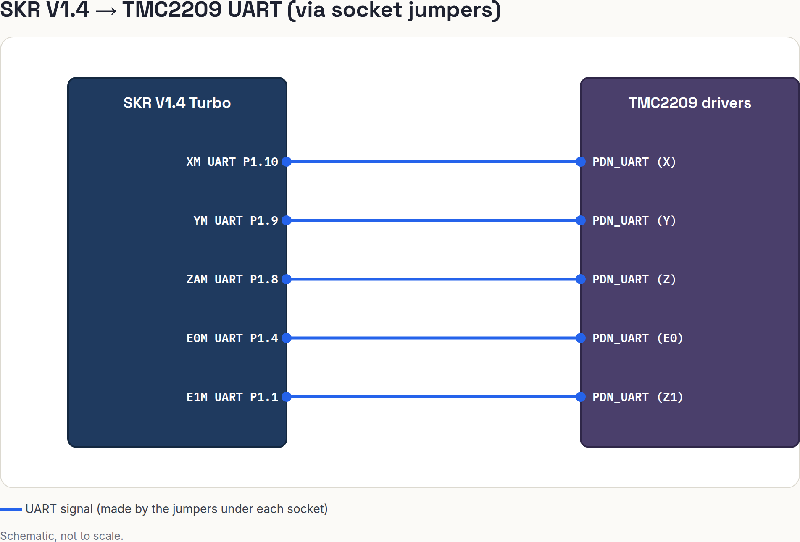

# 01 TMC2209 drivers

Set up five TMC2209 drivers in UART mode on the SKR V1.4: X, Y, Z, E0, and Z1 (the second Z motor, on the E1 socket, per decision 10). Do this on the bench, after `00-power-and-host.md` passed and before any motor is connected.

> **Verify before you install.**
> The jumper layout and the driver orientation are the two ways to destroy a driver or the board.
> The details below come from general knowledge of the SKR V1.4 and the TMC2209 modules, not from this repo's research.
> Items marked **(verify)** must be checked against your board's silkscreen and BTT's V1.4 and TMC2209 manuals.
> The UART pins and the step, dir and enable pins come from research R1.

## Sockets, axes and UART pins

| Socket | Axis | Step / Dir / Enable | UART pin | Klipper section |
| :-- | :-- | :-- | :-- | :-- |
| `XM` | X | P2.2 / P2.6 / !P2.1 | P1.10 | `[tmc2209 stepper_x]` |
| `YM` | Y | P0.19 / P0.20 / !P2.8 | P1.9 | `[tmc2209 stepper_y]` |
| `ZAM` | Z | P0.22 / !P2.11 / !P0.21 | P1.8 | `[tmc2209 stepper_z]` |
| `E0M` | Extruder | P2.13 / !P0.11 / !P2.12 | P1.4 | `[tmc2209 extruder]` |
| `E1M` | Z1 (second Z motor) | P1.15 / P1.14 / !P1.16 | P1.1 | `[tmc2209 stepper_z1]` |

`ZBM` stays empty. Both Z motors use their own drivers (decision 10), so there is no parallel Z wiring.

## Wiring — SKR V1.4 to TMC2209 drivers

| Board Pin | Module Pin | Signal/Function |
| :-- | :-- | :-- |
| `XM` UART `P1.10` | TMC2209 `PDN_UART` (X) | Single-wire UART, X driver |
| `YM` UART `P1.9` | TMC2209 `PDN_UART` (Y) | Single-wire UART, Y driver |
| `ZAM` UART `P1.8` | TMC2209 `PDN_UART` (Z) | Single-wire UART, Z driver |
| `E0M` UART `P1.4` | TMC2209 `PDN_UART` (E0) | Single-wire UART, extruder driver |
| `E1M` UART `P1.1` | TMC2209 `PDN_UART` (Z1) | Single-wire UART, Z1 driver |

The connection is made by the jumpers under each socket, not by wires.

## UART jumpers under each socket

Each driver socket has a small jumper block under it. It selects how the driver is configured.

1. For TMC2209 in **UART mode**, set the jumpers in the position BTT prints for "UART" **(verify against the silkscreen and the V1.4 manual: the exact jumper pins are not in this repo's research)**.
2. Set all five sockets the same way: X, Y, Z, E0 and E1. `ZBM` stays empty.
3. Do not leave stepper-mode (MS1/MS2/MS3) jumpers on a socket that you set for UART.
4. Take a photo of each socket's jumpers before you insert the driver. Photo checkpoint 1.

## DIAG pin: no sensorless homing

Decision 9 uses mechanical X and Y endstops and the CR Touch for Z. There is no sensorless homing. The BTT filament sensor can also conflict with it.

1. Leave the `DIAG` jumpers off. They sit near the endstop connectors **(verify)**.
2. On each driver module, remove the `DIAG` pin or cut it, so the driver cannot drive an endstop line. Use pliers on the pin, or bend it out and tape it. Do this on the bench, with nothing powered.
3. Photo checkpoint 2: each driver's underside, with the `DIAG` pin gone.

## Driver orientation

A driver in backwards can destroy the driver, the board, or both.

1. Look for the socket's silkscreen: it prints the `EN` pin side or an arrow **(verify)**. On most TMC2209 modules the `EN` pin is pin 1, on the same side as the `EN` label.
2. The heatsink goes on top. Stick it on before you insert the driver.
3. Match the `EN` pin of the driver to the `EN` side of the socket. Line up every pin. Press straight down with gentle force.
4. Photo checkpoint 3: each socket from above, with the driver inserted. Check each against the silkscreen once more before you power up.

Only insert or remove a driver with **all power off**: PSU unplugged and USB removed.

## Motor current

In UART mode the current is set in software (`run_current`). The small potentiometer on the module does not set it. Leave the pot where it is.
The first `printer.cfg` uses a low `run_current`, and the T042 jog test confirms the motors turn the right way.

## Checklist

- [ ] `00-power-and-host.md` pre-power checklist is done and the board powered up cleanly.
- [ ] PSU unplugged and USB removed.
- [ ] Jumpers set for UART on `XM`, `YM`, `ZAM`, `E0M` and `E1M`. Photo 1.
- [ ] `DIAG` pins removed or cut, `DIAG` jumpers off. Photo 2.
- [ ] Heatsinks fitted. Drivers oriented to the silkscreen. Photo 3.
- [ ] `ZBM` is empty.
- [ ] No motors connected yet.

## Diagram

